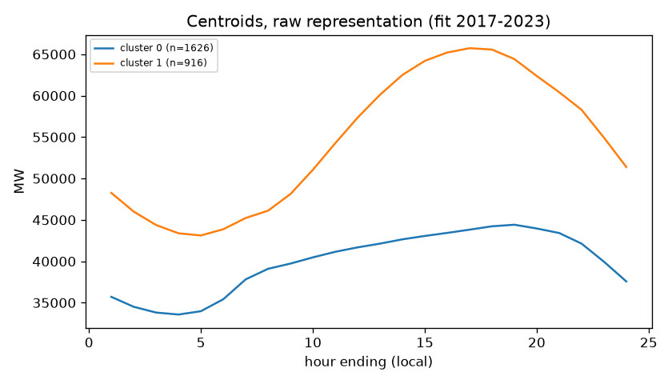
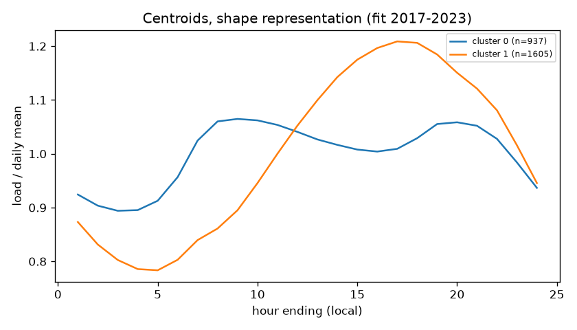
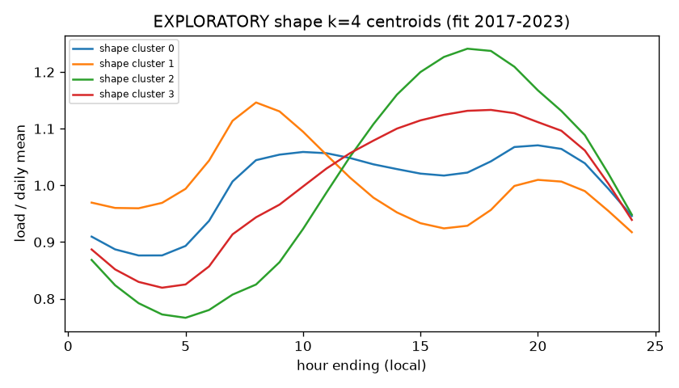

# Module 2: daily load-profile clustering

Fit years 2017-01-01..2023-12-31 (2542 days); check years 2024-01-01..2025-12-31 (727 days); 2026 untouched.
Excluded 19 DST/incomplete days from clustering (row counts [np.int64(23), np.int64(25)]).
Labels describe realized days: they are not forecast inputs.

## Representation: raw

|   k |   silhouette_fit |   silhouette_check |   seed_ari_mean |   seed_ari_min |   boot_ari_mean |   boot_ari_p5 |   min_cluster_share |
|----:|-----------------:|-------------------:|----------------:|---------------:|----------------:|--------------:|--------------------:|
|   2 |            0.521 |              0.273 |           1     |          1     |           0.972 |         0.903 |               0.36  |
|   3 |            0.406 |              0.306 |           1     |          1     |           0.935 |         0.843 |               0.22  |
|   4 |            0.411 |              0.318 |           0.997 |          0.992 |           0.905 |         0.79  |               0.121 |
|   5 |            0.405 |              0.313 |           0.971 |          0.967 |           0.901 |         0.809 |               0.096 |
|   6 |            0.366 |              0.304 |           0.967 |          0.897 |           0.834 |         0.716 |               0.071 |
|   7 |            0.36  |              0.28  |           0.918 |          0.663 |           0.723 |         0.617 |               0.059 |
|   8 |            0.342 |              0.261 |           0.998 |          0.993 |           0.853 |         0.604 |               0.046 |

Selected k = **2** (rule: bootstrap ARI 5th pct >= 0.8, smallest cluster >= 5%, then highest fit silhouette).

Cluster summary (fit + check years; shares per period):

|   label |   days |   mean_mw |   peak_mw |   peak_he_median |   weekend_share |   holiday_share | top_months   |   share_fit |   share_check | representative_day   |
|--------:|-------:|----------:|----------:|-----------------:|----------------:|----------------:|:-------------|------------:|--------------:|:---------------------|
|       0 |   1783 |   40317.1 |   46419.2 |               17 |            0.3  |           0.048 | 3,4,11       |        0.64 |         0.216 | 2022-11-01           |
|       1 |   1486 |   55349   |   66880.6 |               17 |            0.26 |           0.026 | 7,8,6        |        0.36 |         0.784 | 2020-06-30           |

## Representation: shape

|   k |   silhouette_fit |   silhouette_check |   seed_ari_mean |   seed_ari_min |   boot_ari_mean |   boot_ari_p5 |   min_cluster_share |
|----:|-----------------:|-------------------:|----------------:|---------------:|----------------:|--------------:|--------------------:|
|   2 |            0.442 |              0.433 |           0.994 |          0.994 |           0.971 |         0.955 |               0.369 |
|   3 |            0.366 |              0.332 |           0.999 |          0.998 |           0.955 |         0.894 |               0.165 |
|   4 |            0.296 |              0.262 |           0.98  |          0.974 |           0.955 |         0.9   |               0.1   |
|   5 |            0.269 |              0.238 |           0.94  |          0.901 |           0.792 |         0.524 |               0.101 |
|   6 |            0.228 |              0.162 |           0.987 |          0.961 |           0.762 |         0.466 |               0.081 |
|   7 |            0.207 |              0.157 |           0.815 |          0.718 |           0.728 |         0.537 |               0.057 |
|   8 |            0.213 |              0.133 |           0.585 |          0.412 |           0.584 |         0.445 |               0.072 |

Selected k = **2** (rule: bootstrap ARI 5th pct >= 0.8, smallest cluster >= 5%, then highest fit silhouette).

Cluster summary (fit + check years; shares per period):

|   label |   days |   mean_mw |   peak_mw |   peak_he_median |   weekend_share |   holiday_share | top_months   |   share_fit |   share_check | representative_day   |
|--------:|-------:|----------:|----------:|-----------------:|----------------:|----------------:|:-------------|------------:|--------------:|:---------------------|
|       0 |   1227 |   42197.8 |   47013.4 |               14 |           0.288 |           0.058 | 1,12,2       |       0.369 |         0.399 | 2020-04-15           |
|       1 |   2042 |   50126   |   60952.3 |               17 |           0.278 |           0.025 | 7,8,6        |       0.631 |         0.601 | 2021-06-09           |

ARI between raw and shape clusterings: 0.119 (low = they capture different information).

## Exploratory view: shape k=4 (not rule-selected; passes stability criteria)

|   cluster |   days |   peak_he_median |   min_he_median |   peak_to_mean |   weekend_share |   holiday_share | top_months   |
|----------:|-------:|-----------------:|----------------:|---------------:|----------------:|----------------:|:-------------|
|         0 |    688 |               18 |               3 |          1.096 |           0.282 |           0.049 | 12,1,11,2    |
|         1 |    314 |                8 |              17 |          1.148 |           0.312 |           0.086 | 1,12,2,11    |
|         2 |   1323 |               17 |               5 |          1.24  |           0.305 |           0.022 | 7,8,6,9      |
|         3 |    944 |               18 |               4 |          1.153 |           0.238 |           0.035 | 4,3,11,5     |

### Retrospective: E9 validation error by realized shape cluster (after-the-fact; labels use the target day's actual profile)

|   cluster |   val_days |   E9_mae |   E9_bias |   E9_mape_pct |
|----------:|-----------:|---------:|----------:|--------------:|
|         0 |        167 |   1544.1 |    -160.1 |           3   |
|         1 |         61 |   1940   |     305.5 |           3.6 |
|         2 |        251 |   1144.6 |    -176.8 |           1.9 |
|         3 |        248 |   1166   |      13   |           2.2 |

Interpretation: see [clustering_interpretation.md](clustering_interpretation.md).
